# APEX Setproduct Themes

Claude Code skills that make an **Oracle APEX** app look like one of the [Setproduct](https://www.setproduct.com/all)
UI kits, while staying on **native Universal Theme 42** components.

- One skill per kit (`skills/apex-theme-<kit>/`) with a ready-to-upload CSS file per light/dark mode,
  the kit's tokens, a kit-pattern -> native-component recipe table and a chart palette.
- One router skill (`skills/apex-setproduct-themes/`) with the shared method, install guide,
  full component map and the verified Universal Theme variable list.
- A generator (`build.py`) so every theme comes from one data file (`src/themes.py`) and one bridge
  stylesheet (`src/base.css`).
- A swatch gallery at `docs/index.html` (works as GitHub Pages).

## How it works
```
src/themes.py  --tokens-->  --sp-* variables
src/base.css   --maps-->    --ut-* / --a-* Universal Theme variables (verified on APEX 24.1/24.2)
                            + side-menu selector overrides (Vita hard-codes those)
                            + optional sp-* utility classes per kit
build.py       --writes-->  skills/apex-theme-<kit>/theme-<mode>.css + SKILL.md
```
In APEX you upload one CSS file, save a Theme Style from **Vita** / **Vita - Dark** that references it,
and build pages with stock regions, template components and Template Options.

## Screenshots
Each look applied to Oracle's own Universal Theme reference app (APEX 26.2, Interactive Report page) using
only the theme's CSS file on top of stock markup - no template changes. Both modes shown where a kit has them; click an image to enlarge or a name for the skill.

<!-- SCREENSHOTS:START -->
<table>
<tr><td width="50%" valign="top"><a href="docs/screenshots/eclipse.jpg"></a> <a href="docs/screenshots/eclipse-light.jpg">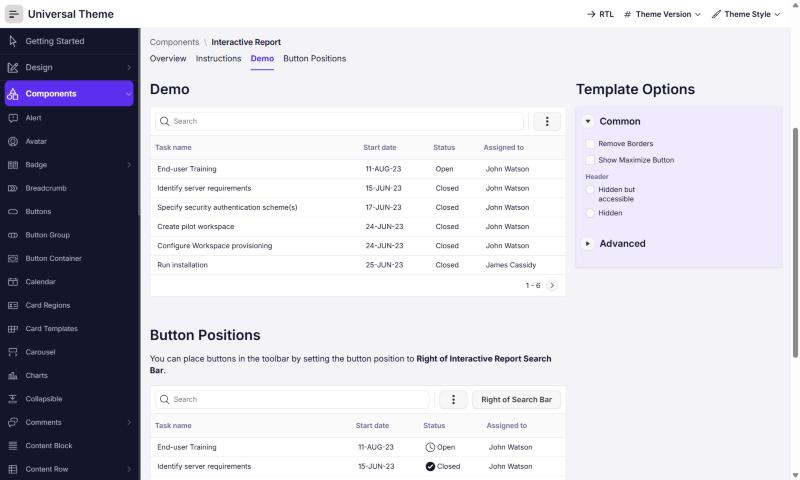</a><br><a href="skills/apex-theme-eclipse/SKILL.md"><b>Eclipse</b></a> &middot; dark / light<br><sub>dark-first data dashboard: near-black canvas, electric violet and cyan, gradient KPI cards</sub></td><td width="50%" valign="top"><a href="docs/screenshots/panda.jpg"></a> <a href="docs/screenshots/panda-dark.jpg">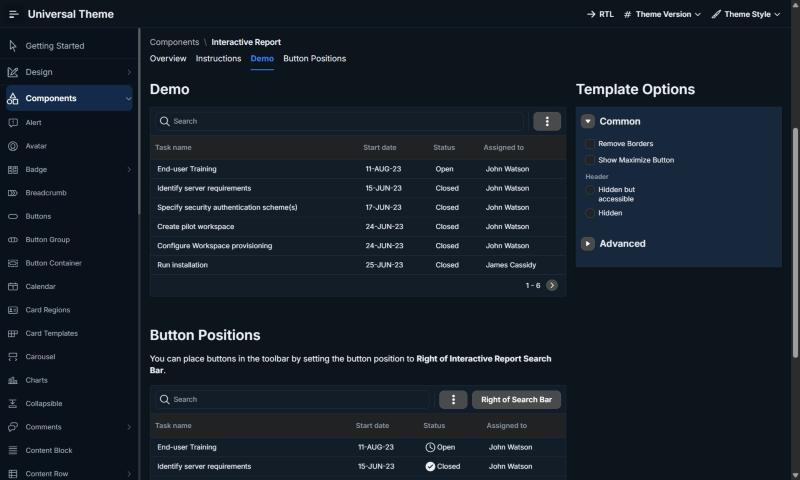</a><br><a href="skills/apex-theme-panda/SKILL.md"><b>Panda</b></a> &middot; light / dark<br><sub>clean modern web-app dashboard: white cards, dark navy sidebar, confident blue</sub></td></tr>
<tr><td width="50%" valign="top"><a href="docs/screenshots/rome.jpg"></a><br><a href="skills/apex-theme-rome/SKILL.md"><b>Rome</b></a> &middot; light<br><sub>airy light dashboard: periwinkle blue, peach and pink accents, soft tinted shadows</sub></td><td width="50%" valign="top"><a href="docs/screenshots/neolex.jpg"></a> <a href="docs/screenshots/neolex-dark.jpg">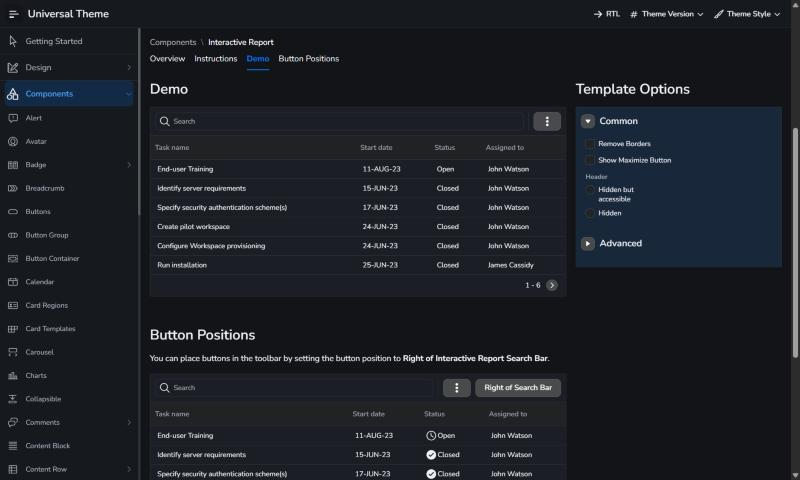</a><br><a href="skills/apex-theme-neolex/SKILL.md"><b>Neolex</b></a> &middot; light / dark<br><sub>8dp-grid responsive dashboard: bright azure, orange and purple accents, crisp light greys</sub></td></tr>
<tr><td width="50%" valign="top"><a href="docs/screenshots/react-ui-kit.jpg"></a> <a href="docs/screenshots/react-ui-kit-dark.jpg">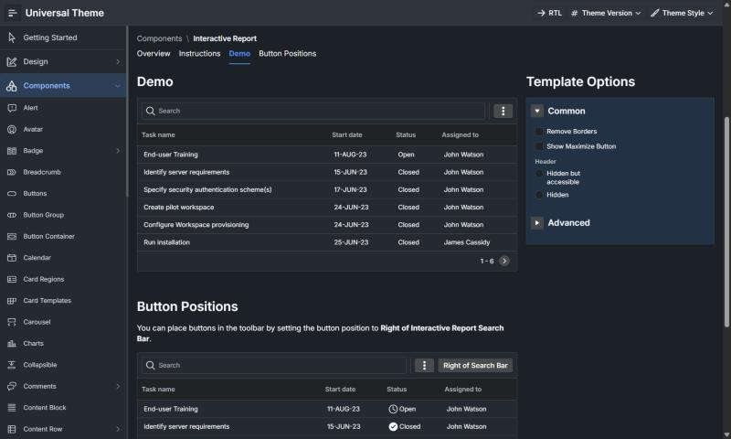</a><br><a href="skills/apex-theme-react-ui-kit/SKILL.md"><b>React UI kit (Blueprint)</b></a> &middot; light / dark<br><sub>data-dense Blueprint.js-style desktop UI: tight spacing, 3px radii, inset borders</sub></td><td width="50%" valign="top"><a href="docs/screenshots/xela.jpg"></a> <a href="docs/screenshots/xela-dark.jpg">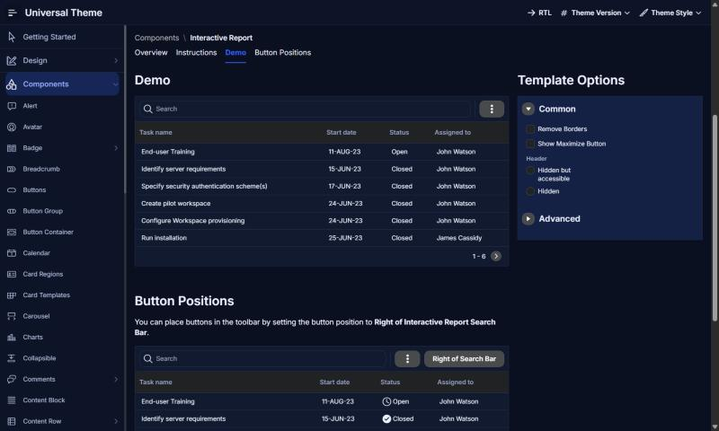</a><br><a href="skills/apex-theme-xela/SKILL.md"><b>Xela</b></a> &middot; light / dark<br><sub>cross-platform (React/Swift/Android/Flutter) system: royal blue, crisp white, easy dark toggle</sub></td></tr>
<tr><td width="50%" valign="top"><a href="docs/screenshots/material-you.jpg"></a> <a href="docs/screenshots/material-you-dark.jpg">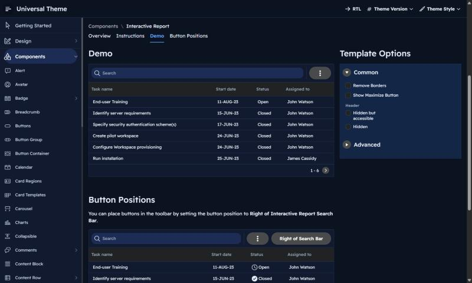</a><br><a href="skills/apex-theme-material-you/SKILL.md"><b>Material You</b></a> &middot; light / dark<br><sub>Material Design 3 with Tailwind palette and Readex Pro: tonal surfaces, pill buttons</sub></td><td width="50%" valign="top"><a href="docs/screenshots/material-x.jpg">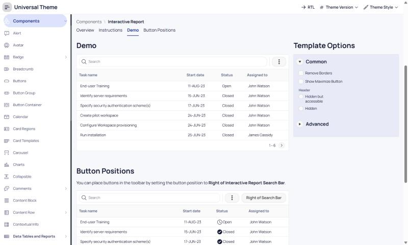</a><br><a href="skills/apex-theme-material-x/SKILL.md"><b>Material X</b></a> &middot; light<br><sub>Material beyond Material: Manrope type, deep indigo + teal, top-notch rounded shapes</sub></td></tr>
<tr><td width="50%" valign="top"><a href="docs/screenshots/material.jpg"></a> <a href="docs/screenshots/material-dark.jpg">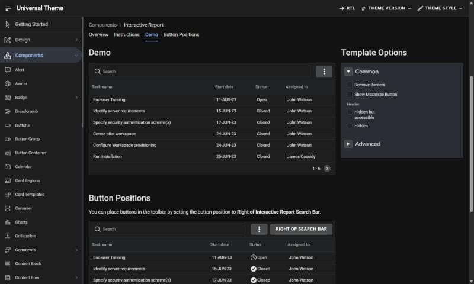</a><br><a href="skills/apex-theme-material/SKILL.md"><b>Material Design System</b></a> &middot; light / dark<br><sub>classic Material Design (material.io): Roboto + Red Hat Display, elevation shadows, 4px radii</sub></td><td width="50%" valign="top"><a href="docs/screenshots/nocra.jpg"></a> <a href="docs/screenshots/nocra-light.jpg">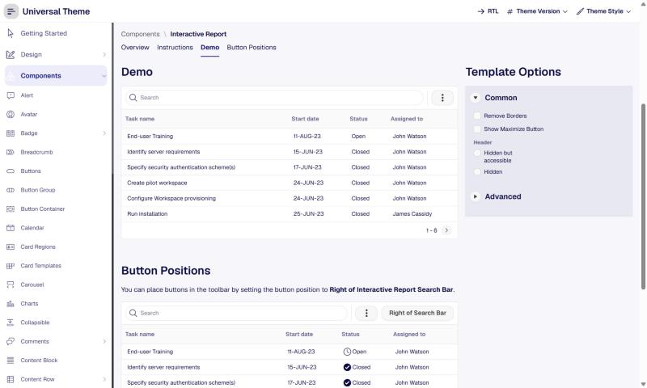</a><br><a href="skills/apex-theme-nocra/SKILL.md"><b>Nocra</b></a> &middot; dark / light<br><sub>AI-product design system: deep midnight navy, mint CTAs, prompt inputs, thinking-state motion</sub></td></tr>
<tr><td width="50%" valign="top"><a href="docs/screenshots/orion.jpg">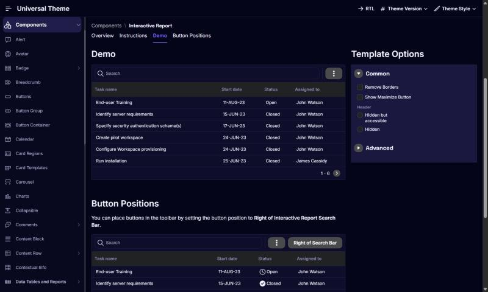</a> <a href="docs/screenshots/orion-light.jpg">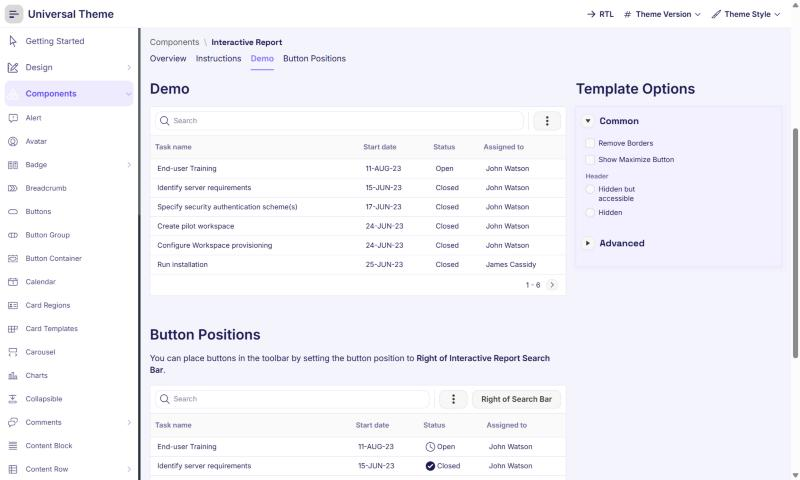</a><br><a href="skills/apex-theme-orion/SKILL.md"><b>Orion</b></a> &middot; dark / light<br><sub>space-themed dataviz: deep indigo night, neon violet/cyan, glowing maps, hexagons and bubbles</sub></td><td width="50%" valign="top"><a href="docs/screenshots/charts.jpg"></a> <a href="docs/screenshots/charts-dark.jpg">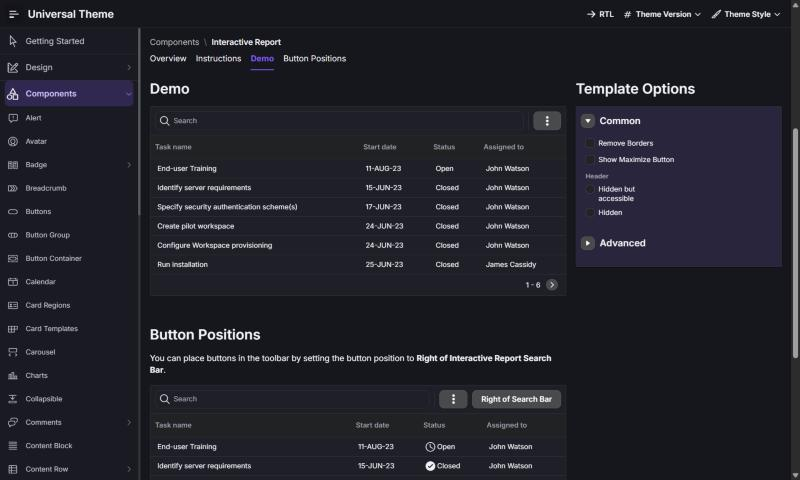</a><br><a href="skills/apex-theme-charts/SKILL.md"><b>Figma Charts</b></a> &middot; light / dark<br><sub>component-driven chart library: pastel-bright violet/blue/mint/peach series on clean white cards</sub></td></tr>
<tr><td width="50%" valign="top"><a href="docs/screenshots/hyper-charts.jpg"></a> <a href="docs/screenshots/hyper-charts-dark.jpg">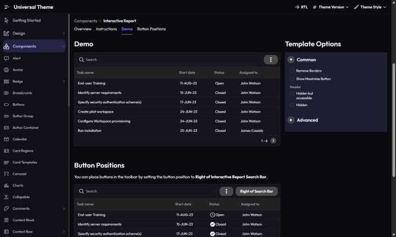</a><br><a href="skills/apex-theme-hyper-charts/SKILL.md"><b>Hyper Charts</b></a> &middot; light / dark<br><sub>1000+ chart blocks: indigo and fresh green on lavender-tinted cards, rounded and airy</sub></td><td width="50%" valign="top"><a href="docs/screenshots/nucleus.jpg"></a> <a href="docs/screenshots/nucleus-dark.jpg">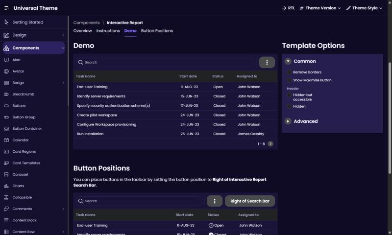</a><br><a href="skills/apex-theme-nucleus/SKILL.md"><b>Nucleus UI</b></a> &middot; light / dark<br><sub>1000+ component mobile system: vivid violet, sunshine-yellow highlights, rounded friendly UI</sub></td></tr>
<tr><td width="50%" valign="top"><a href="docs/screenshots/mobile-x.jpg"></a> <a href="docs/screenshots/mobile-x-dark.jpg">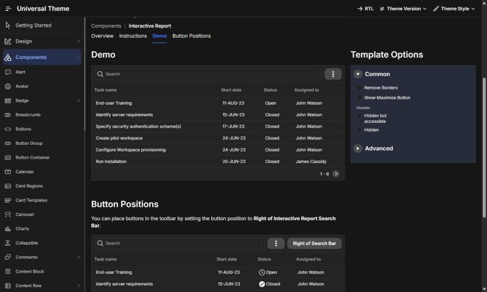</a><br><a href="skills/apex-theme-mobile-x/SKILL.md"><b>Mobile X</b></a> &middot; light / dark<br><sub>iOS/Android cross-platform kit: clear blue, lime highlight, 8dp grid, toggleable dark variants</sub></td><td width="50%" valign="top"><a href="docs/screenshots/appka-ios.jpg"></a> <a href="docs/screenshots/appka-ios-dark.jpg">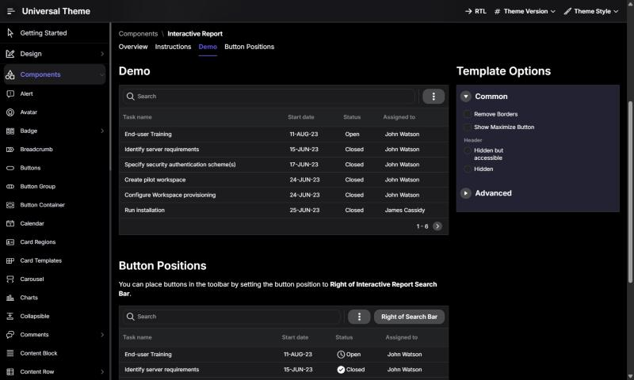</a><br><a href="skills/apex-theme-appka-ios/SKILL.md"><b>Appka iOS</b></a> &middot; light / dark<br><sub>Apple-spec iOS system: grouped inset lists, SF-style type, system blue-violet, true-black dark</sub></td></tr>
<tr><td width="50%" valign="top"><a href="docs/screenshots/android.jpg">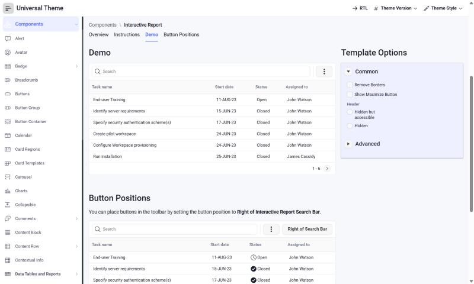</a><br><a href="skills/apex-theme-android/SKILL.md"><b>Android UI kit</b></a> &middot; light<br><sub>Android app templates: indigo-blue, amber accents, Roboto, elevation cards</sub></td><td width="50%" valign="top"><a href="docs/screenshots/zeus.jpg"></a><br><a href="skills/apex-theme-zeus/SKILL.md"><b>Zeus</b></a> &middot; light<br><sub>landing-page system: teal + violet on white, dark hero bands, pill CTAs, 630+ web blocks</sub></td></tr>
<tr><td width="50%" valign="top"><a href="docs/screenshots/landing.jpg"></a><br><a href="skills/apex-theme-landing/SKILL.md"><b>Figma Landing Pages</b></a> &middot; light<br><sub>colourful, trendy landing blocks: violet, sunshine yellow, mint on bright colour-block sections</sub></td><td width="50%" valign="top"><a href="docs/screenshots/website.jpg"></a> <a href="docs/screenshots/website-dark.jpg">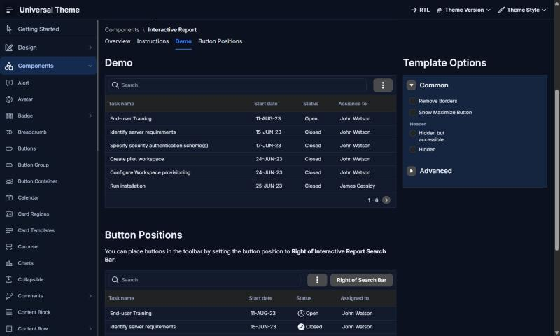</a><br><a href="skills/apex-theme-website/SKILL.md"><b>Figma Website templates</b></a> &middot; light / dark<br><sub>140+ dark &amp; light website blocks: trustworthy blue, coral accent, mixable light/dark sections</sub></td></tr>
<tr><td width="50%" valign="top"><a href="docs/screenshots/claylo.jpg"></a><br><a href="skills/apex-theme-claylo/SKILL.md"><b>Claylo</b></a> &middot; light<br><sub>claymorphism: warm cream canvas, puffy pastel clay cards, chunky 3D push buttons, Fredoka</sub></td><td width="50%" valign="top"><a href="docs/screenshots/levitate.jpg">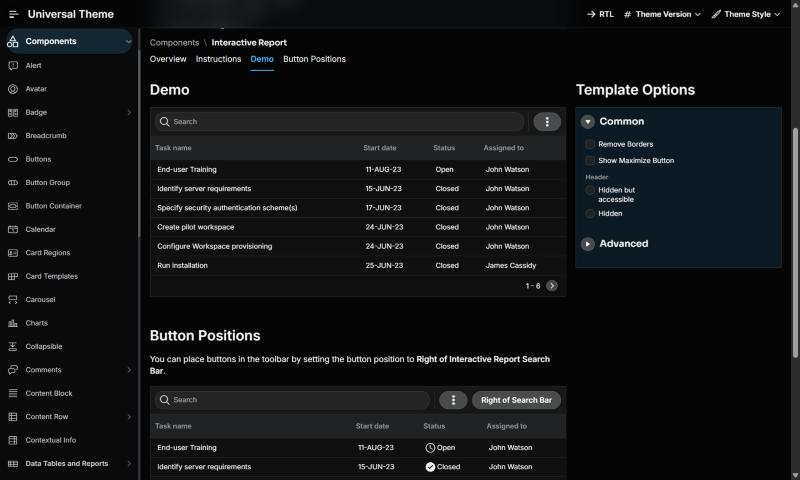</a><br><a href="skills/apex-theme-levitate/SKILL.md"><b>Levitate</b></a> &middot; dark<br><sub>3D scene presentation style: jet-black stage, neon sky/green/violet, glassy floating panels</sub></td></tr>
</table>
<!-- SCREENSHOTS:END -->

## Themes
<!-- THEMES:START -->
| Theme | Category | Modes | Look |
|---|---|---|---|
| [Eclipse](skills/apex-theme-eclipse/SKILL.md) | Dashboard | dark, light | dark-first data dashboard: near-black canvas, electric violet and cyan, gradient KPI cards |
| [Panda](skills/apex-theme-panda/SKILL.md) | Dashboard | light, dark | clean modern web-app dashboard: white cards, dark navy sidebar, confident blue |
| [Rome](skills/apex-theme-rome/SKILL.md) | Dashboard | light | airy light dashboard: periwinkle blue, peach and pink accents, soft tinted shadows |
| [Neolex](skills/apex-theme-neolex/SKILL.md) | Dashboard | light, dark | 8dp-grid responsive dashboard: bright azure, orange and purple accents, crisp light greys |
| [React UI kit (Blueprint)](skills/apex-theme-react-ui-kit/SKILL.md) | Dashboard | light, dark | data-dense Blueprint.js-style desktop UI: tight spacing, 3px radii, inset borders |
| [Xela](skills/apex-theme-xela/SKILL.md) | Dashboard | light, dark | cross-platform (React/Swift/Android/Flutter) system: royal blue, crisp white, easy dark toggle |
| [Material You](skills/apex-theme-material-you/SKILL.md) | Material | light, dark | Material Design 3 with Tailwind palette and Readex Pro: tonal surfaces, pill buttons |
| [Material X](skills/apex-theme-material-x/SKILL.md) | Material | light | Material beyond Material: Manrope type, deep indigo + teal, top-notch rounded shapes |
| [Material Design System](skills/apex-theme-material/SKILL.md) | Material | light, dark | classic Material Design (material.io): Roboto + Red Hat Display, elevation shadows, 4px radii |
| [Nocra](skills/apex-theme-nocra/SKILL.md) | AI product | dark, light | AI-product design system: deep midnight navy, mint CTAs, prompt inputs, thinking-state motion |
| [Orion](skills/apex-theme-orion/SKILL.md) | Data visualization | dark, light | space-themed dataviz: deep indigo night, neon violet/cyan, glowing maps, hexagons and bubbles |
| [Figma Charts](skills/apex-theme-charts/SKILL.md) | Data visualization | light, dark | component-driven chart library: pastel-bright violet/blue/mint/peach series on clean white cards |
| [Hyper Charts](skills/apex-theme-hyper-charts/SKILL.md) | Data visualization | light, dark | 1000+ chart blocks: indigo and fresh green on lavender-tinted cards, rounded and airy |
| [Nucleus UI](skills/apex-theme-nucleus/SKILL.md) | Mobile | light, dark | 1000+ component mobile system: vivid violet, sunshine-yellow highlights, rounded friendly UI |
| [Mobile X](skills/apex-theme-mobile-x/SKILL.md) | Mobile | light, dark | iOS/Android cross-platform kit: clear blue, lime highlight, 8dp grid, toggleable dark variants |
| [Appka iOS](skills/apex-theme-appka-ios/SKILL.md) | Mobile | light, dark | Apple-spec iOS system: grouped inset lists, SF-style type, system blue-violet, true-black dark |
| [Android UI kit](skills/apex-theme-android/SKILL.md) | Mobile | light | Android app templates: indigo-blue, amber accents, Roboto, elevation cards |
| [Zeus](skills/apex-theme-zeus/SKILL.md) | Landing pages | light | landing-page system: teal + violet on white, dark hero bands, pill CTAs, 630+ web blocks |
| [Figma Landing Pages](skills/apex-theme-landing/SKILL.md) | Landing pages | light | colourful, trendy landing blocks: violet, sunshine yellow, mint on bright colour-block sections |
| [Figma Website templates](skills/apex-theme-website/SKILL.md) | Landing pages | light, dark | 140+ dark & light website blocks: trustworthy blue, coral accent, mixable light/dark sections |
| [Claylo](skills/apex-theme-claylo/SKILL.md) | Landing pages | light | claymorphism: warm cream canvas, puffy pastel clay cards, chunky 3D push buttons, Fredoka |
| [Levitate](skills/apex-theme-levitate/SKILL.md) | Landing pages | dark | 3D scene presentation style: jet-black stage, neon sky/green/violet, glassy floating panels |
<!-- THEMES:END -->

## Install the skills (Claude Code)
Windows:
```powershell
./install.ps1
```
macOS / Linux:
```bash
./install.sh
```
Both copy `skills/*` into `~/.claude/skills/`. Then ask Claude, for example:
"apply the Panda theme to app 127" or "which Setproduct look suits an analytics app?".

## Apply a theme by hand (no Claude)
1. Upload `skills/apex-theme-<kit>/theme-<mode>.css` to **Static Application Files** (`setproduct/<kit>-<mode>.css`).
2. Theme Roller: pick **Vita** (light) or **Vita - Dark** (dark), **Save As** a new style.
3. Shared Components > Themes > Theme Styles > your style: **CSS File URLs** = `#APP_FILES#setproduct/<kit>-<mode>.css`, **Is Current**.
4. Build pages with native components - see the kit's SKILL.md recipe table.

Full guide: [`skills/apex-setproduct-themes/references/install.md`](skills/apex-setproduct-themes/references/install.md).

## Edit or add themes
```bash
python build.py
```
Change tokens in `src/themes.py` or the bridge in `src/base.css`, rebuild, re-upload. Adding a kit:
[`references/new-theme.md`](skills/apex-setproduct-themes/references/new-theme.md).

## Notes
- Colours are approximations sampled from Setproduct's public preview images; fonts come from the kit
  descriptions where stated. This repo contains **no Setproduct assets**. For exact values, buy the kit
  and copy its tokens into `src/themes.py`.
- Setproduct and the kit names are trademarks of their owners; this project is unaffiliated.
- Requires browsers with CSS `color-mix()` (all evergreen browsers since 2023).
