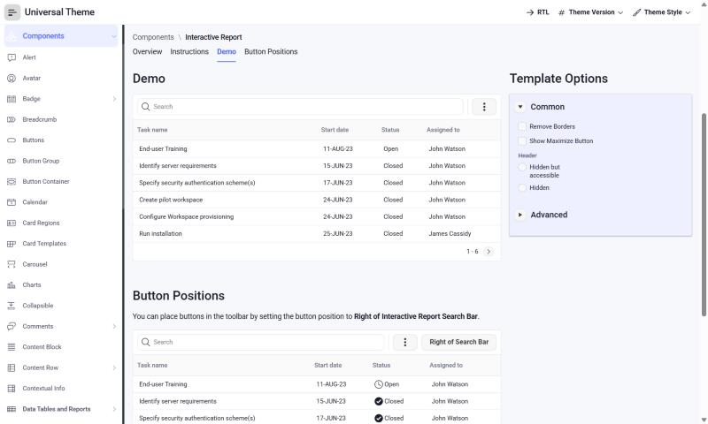

# Setproduct Android UI kit -> Oracle APEX

**Category:** Mobile  |  **Kit:** https://www.setproduct.com/templates/android-ui-kit  |  **Modes:** light (default light)

Read `../apex-setproduct-themes/SKILL.md` first for the shared method (native-first rules, install steps,
component map). This file only holds what is specific to Android UI kit.

## Preview


*Light mode on Oracle's Universal Theme reference app (APEX 26.2, Interactive Report page, stock markup + this theme's CSS only).*

## The look
- Indigo-blue primary, amber/orange accents, Roboto type.
- Elevated photo cards, filters, maps, planners, wishlists - 140 templates.

**Fonts:** body `Roboto`, headings `Roboto` (loaded from Google Fonts by the CSS `@import`;
self-host them as Static Application Files if the app's CSP blocks fonts.googleapis.com).

## Files
- `theme-light.css` - light mode; create the Theme Style from **Vita** (default)

Each file is self-contained (font import + `--sp-*` tokens + base bridge + Android UI kit signature rules).

## Key tokens (light)
| Token | Value |
|---|---|
| `--sp-primary` | `#546CFC` |
| `--sp-accent` | `#FC9C04` |
| `--sp-success` | `#2EB872` |
| `--sp-warning` | `#FC9C04` |
| `--sp-danger` | `#F0445A` |
| `--sp-info` | `#2C7CEC` |
| `--sp-bg` | `#F7F8FC` |
| `--sp-surface` | `#FFFFFF` |
| `--sp-border` | `#E3E6EF` |
| `--sp-text` | `#1A1D29` |
| `--sp-text-muted` | `#6B7083` |
| `--sp-nav-bg` | `#FFFFFF` |
| `--sp-nav-active-bg` | `#ECEFFF` |
| `--sp-radius-md` | `8px` |
| `--sp-radius-lg` | `12px` |
| `--sp-btn-radius` | `8px` |

To re-tint, change tokens in `src/themes.py` and run `python build.py` - or override just the `--sp-*`
variables in Theme Roller's **Custom CSS** box, which loads after the file.

## Build it with native components
| Kit element | Native APEX implementation |
|---|---|
| Photo cards | Cards region, Media Source = Image, Layout = Grid |
| Filters | Faceted Search region |
| Maps | Map region (native) |

Everything else follows the shared component map (`../apex-setproduct-themes/references/component-map.md`).

**Signature utility classes** (put in a region's or item's *Appearance > CSS Classes*): none - the base layer covers this kit

## Charts
Paste into each Chart region's **Attributes > Advanced > Initialization JavaScript Function**:

```javascript
function( options ) {
    options.styleDefaults = options.styleDefaults || {};
    options.styleDefaults.colors = [ "#546CFC", "#FC9C04", "#2C7CEC", "#74B4DC", "#2EB872", "#F0445A", "#A4CCFC", "#FCECC4" ];
    return options;
}
```

## Dark / light
This kit is light-only; no second style is needed.

## Verify
1. Run a page with a Side Menu, a Cards region, an Interactive Report, a form with Floating labels and a Hot button.
2. Check the side menu's current item, focus rings (Tab key), Hot button contrast, and the IR header in both modes.
3. Check the Login page (page template *Login*) and a Modal Dialog.
4. Compare side by side with the kit preview at https://www.setproduct.com/templates/android-ui-kit and nudge tokens, not selectors.
