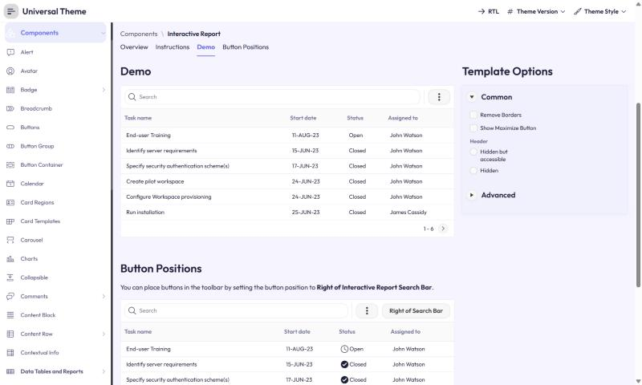

# Setproduct Hyper Charts -> Oracle APEX

**Category:** Data visualization  |  **Kit:** https://www.setproduct.com/templates/hyper-charts  |  **Modes:** light, dark (default light)

Read `../apex-setproduct-themes/SKILL.md` first for the shared method (native-first rules, install steps,
component map). This file only holds what is specific to Hyper Charts.

## Preview


*Light mode on Oracle's Universal Theme reference app (APEX 26.2, Interactive Report page, stock markup + this theme's CSS only).*

## The look
- Indigo + fresh green series, sky and lavender supporting colours.
- Chart cards with big rounded corners and dollar-figure headlines; full dark mode.

**Fonts:** body `Outfit`, headings `Outfit` (loaded from Google Fonts by the CSS `@import`;
self-host them as Static Application Files if the app's CSP blocks fonts.googleapis.com).

## Files
- `theme-light.css` - light mode; create the Theme Style from **Vita** (default)
- `theme-dark.css` - dark mode; create the Theme Style from **Vita - Dark**

Each file is self-contained (font import + `--sp-*` tokens + base bridge + Hyper Charts signature rules).

## Key tokens (light)
| Token | Value |
|---|---|
| `--sp-primary` | `#6C74E4` |
| `--sp-accent` | `#4CDC6C` |
| `--sp-success` | `#4CDC6C` |
| `--sp-warning` | `#FFB86B` |
| `--sp-danger` | `#FC6C6C` |
| `--sp-info` | `#5CD4FC` |
| `--sp-bg` | `#F6F5FF` |
| `--sp-surface` | `#FFFFFF` |
| `--sp-border` | `#E9E7FA` |
| `--sp-text` | `#1E1F3A` |
| `--sp-text-muted` | `#727497` |
| `--sp-nav-bg` | `#FFFFFF` |
| `--sp-nav-active-bg` | `#ECEDFC` |
| `--sp-radius-md` | `12px` |
| `--sp-radius-lg` | `20px` |
| `--sp-btn-radius` | `12px` |

To re-tint, change tokens in `src/themes.py` and run `python build.py` - or override just the `--sp-*`
variables in Theme Roller's **Custom CSS** box, which loads after the file.

## Build it with native components
| Kit element | Native APEX implementation |
|---|---|
| Chart blocks | Chart region per block; group 2-4 per row with Column Span in Layout |
| Headline figure + delta | Cards region with the Badge slot for the delta |

Everything else follows the shared component map (`../apex-setproduct-themes/references/component-map.md`).

**Signature utility classes** (put in a region's or item's *Appearance > CSS Classes*): none - the base layer covers this kit

## Charts
Paste into each Chart region's **Attributes > Advanced > Initialization JavaScript Function**:

```javascript
function( options ) {
    options.styleDefaults = options.styleDefaults || {};
    options.styleDefaults.colors = [ "#6C74E4", "#4CDC6C", "#5CD4FC", "#DCC4FC", "#FFB86B", "#FC6C6C", "#ACB4F4", "#FCECC4" ];
    return options;
}
```

## Dark / light
Both modes ship. Create one Theme Style per mode, mark both **Is Public = Yes**, and in Shared Components > User Interface Attributes enable end users to choose the theme style, so users can switch from the runtime *Customize* dialog (see `references/install.md` step 3).

## Verify
1. Run a page with a Side Menu, a Cards region, an Interactive Report, a form with Floating labels and a Hot button.
2. Check the side menu's current item, focus rings (Tab key), Hot button contrast, and the IR header in both modes.
3. Check the Login page (page template *Login*) and a Modal Dialog.
4. Compare side by side with the kit preview at https://www.setproduct.com/templates/hyper-charts and nudge tokens, not selectors.
