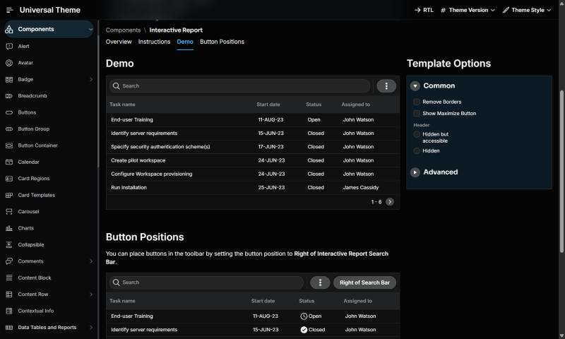

# Setproduct Levitate -> Oracle APEX

**Category:** Landing pages  |  **Kit:** https://www.setproduct.com/templates/levitate  |  **Modes:** dark (default dark)

Read `../apex-setproduct-themes/SKILL.md` first for the shared method (native-first rules, install steps,
component map). This file only holds what is specific to Levitate.

## Preview


*Dark mode on Oracle's Universal Theme reference app (APEX 26.2, Interactive Report page, stock markup + this theme's CSS only).*

## The look
- Jet-black stage with floating 3D objects; neon sky blue, mint green, violet and pink.
- Glassy translucent panels; pill CTAs; bold display headlines.
- Made for covers, CTAs and presentations - pair with your own 3D renders as images.

**Fonts:** body `Inter`, headings `Sora` (loaded from Google Fonts by the CSS `@import`;
self-host them as Static Application Files if the app's CSP blocks fonts.googleapis.com).

## Files
- `theme-dark.css` - dark mode; create the Theme Style from **Vita - Dark** (default)

Each file is self-contained (font import + `--sp-*` tokens + base bridge + Levitate signature rules).

## Key tokens (dark)
| Token | Value |
|---|---|
| `--sp-primary` | `#44BCFC` |
| `--sp-accent` | `#14FC9C` |
| `--sp-success` | `#14FC9C` |
| `--sp-warning` | `#FFC857` |
| `--sp-danger` | `#FC6CC4` |
| `--sp-info` | `#944CFC` |
| `--sp-bg` | `#050505` |
| `--sp-surface` | `rgba(255,255,255,.04)` |
| `--sp-border` | `rgba(255,255,255,.10)` |
| `--sp-text` | `#F5F5F7` |
| `--sp-text-muted` | `#9A9AA3` |
| `--sp-nav-bg` | `#0A0A0B` |
| `--sp-nav-active-bg` | `rgba(68,188,252,.16)` |
| `--sp-radius-md` | `16px` |
| `--sp-radius-lg` | `28px` |
| `--sp-btn-radius` | `999px` |

To re-tint, change tokens in `src/themes.py` and run `python build.py` - or override just the `--sp-*`
variables in Theme Roller's **Custom CSS** box, which loads after the file.

## Build it with native components
| Kit element | Native APEX implementation |
|---|---|
| Glass panels | Any region + CSS class `sp-glass` |
| 3D hero | Hero region with Display Image = your rendered PNG (Static Application File) |
| Green statement section | Static Content + CSS class `sp-section-neon` |

Everything else follows the shared component map (`../apex-setproduct-themes/references/component-map.md`).

**Signature utility classes** (put in a region's or item's *Appearance > CSS Classes*): `sp-glass`, `sp-section-neon`

## Charts
Paste into each Chart region's **Attributes > Advanced > Initialization JavaScript Function**:

```javascript
function( options ) {
    options.styleDefaults = options.styleDefaults || {};
    options.styleDefaults.colors = [ "#44BCFC", "#14FC9C", "#944CFC", "#FC6CC4", "#847CF4", "#FFC857", "#04144C", "#A5F3FC" ];
    return options;
}
```

## Dark / light
This kit is dark-only; no second style is needed.

## Verify
1. Run a page with a Side Menu, a Cards region, an Interactive Report, a form with Floating labels and a Hot button.
2. Check the side menu's current item, focus rings (Tab key), Hot button contrast, and the IR header in both modes.
3. Check the Login page (page template *Login*) and a Modal Dialog.
4. Compare side by side with the kit preview at https://www.setproduct.com/templates/levitate and nudge tokens, not selectors.
