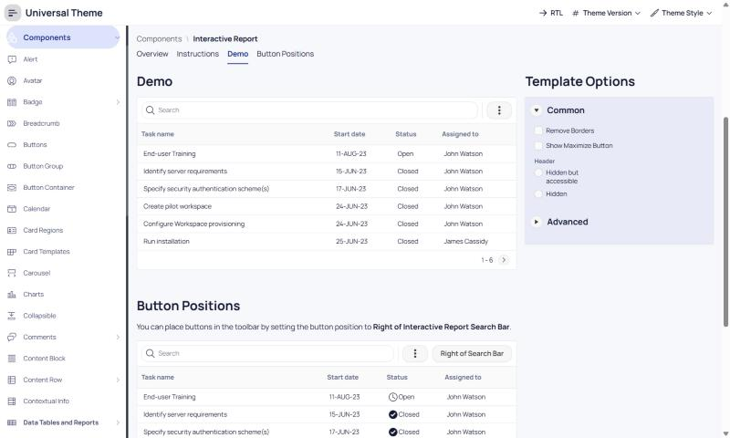

# Setproduct Material X -> Oracle APEX

**Category:** Material  |  **Kit:** https://www.setproduct.com/templates/material-x  |  **Modes:** light (default light)

Read `../apex-setproduct-themes/SKILL.md` first for the shared method (native-first rules, install steps,
component map). This file only holds what is specific to Material X.

## Preview
**Light**



*Oracle's Universal Theme reference app (APEX 26.2, Interactive Report page), stock markup + this theme's CSS only.*

## The look
- Material foundations with bolder shapes: 16-24px radii and asymmetric 'notch' corners on hero cards.
- Deep indigo primary, teal accent, white surfaces on a cool off-white canvas.
- Manrope typeface throughout; 40 desktop/tablet/mobile app templates (Angular port exists).

**Fonts:** body `Manrope`, headings `Manrope` (loaded from Google Fonts by the CSS `@import`;
self-host them as Static Application Files if the app's CSP blocks fonts.googleapis.com).

## Files
- `theme-light.css` - light mode; create the Theme Style from **Vita** (default)

Each file is self-contained (font import + `--sp-*` tokens + base bridge + Material X signature rules).

## Key tokens (light)
| Token | Value |
|---|---|
| `--sp-primary` | `#24348C` |
| `--sp-accent` | `#5CC4B4` |
| `--sp-success` | `#248C24` |
| `--sp-warning` | `#F2A93B` |
| `--sp-danger` | `#D6455D` |
| `--sp-info` | `#5464A4` |
| `--sp-bg` | `#F7F8FC` |
| `--sp-surface` | `#FFFFFF` |
| `--sp-border` | `#E3E6F0` |
| `--sp-text` | `#141A33` |
| `--sp-text-muted` | `#626A86` |
| `--sp-nav-bg` | `#FFFFFF` |
| `--sp-nav-active-bg` | `#DDE3FA` |
| `--sp-radius-md` | `12px` |
| `--sp-radius-lg` | `20px` |
| `--sp-btn-radius` | `12px` |

To re-tint, change tokens in `src/themes.py` and run `python build.py` - or override just the `--sp-*`
variables in Theme Roller's **Custom CSS** box, which loads after the file.

## Build it with native components
| Kit element | Native APEX implementation |
|---|---|
| Notched hero card | Static Content / Cards region + CSS class `sp-notch` |
| Steppers / counters | Number Field + two Icon buttons (Template Option `Button Set`) |
| Top app bar | Page template Standard with Navigation Menu Position = Top (Top Navigation Menu list) |
| Data cards | Cards region (Layout = Grid) with Icon/Media slot |

Everything else follows the shared component map (`../apex-setproduct-themes/references/component-map.md`).

**Signature utility classes** (put in a region's or item's *Appearance > CSS Classes*): `sp-notch`

## Charts
Paste into each Chart region's **Attributes > Advanced > Initialization JavaScript Function**:

```javascript
function( options ) {
    options.styleDefaults = options.styleDefaults || {};
    options.styleDefaults.colors = [ "#24348C", "#5CC4B4", "#5464A4", "#9CDCD4", "#F2A93B", "#D6455D", "#248C24", "#ACFCF4" ];
    return options;
}
```

## Dark / light
This kit is light-only; no second style is needed.

## Verify
1. Run a page with a Side Menu, a Cards region, an Interactive Report, a form with Floating labels and a Hot button.
2. Check the side menu's current item, focus rings (Tab key), Hot button contrast, and the IR header in both modes.
3. Check the Login page (page template *Login*) and a Modal Dialog.
4. Compare side by side with the kit preview at https://www.setproduct.com/templates/material-x and nudge tokens, not selectors.
