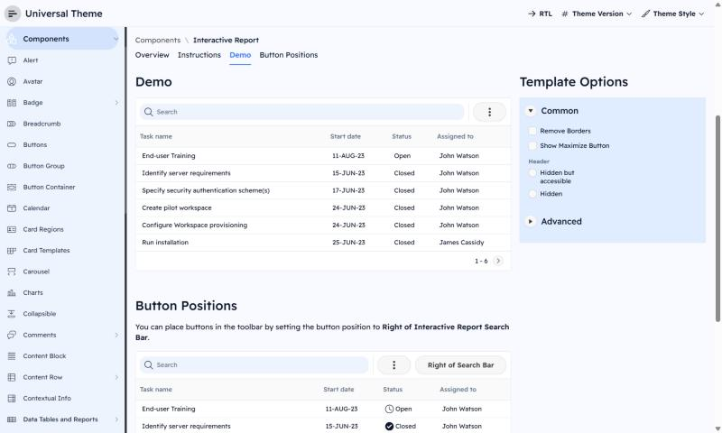

# Setproduct Material You -> Oracle APEX

**Category:** Material  |  **Kit:** https://www.setproduct.com/templates/material-you  |  **Modes:** light, dark (default light)

Read `../apex-setproduct-themes/SKILL.md` first for the shared method (native-first rules, install steps,
component map). This file only holds what is specific to Material You.

## Preview


*Light mode on Oracle's Universal Theme reference app (APEX 26.2, Interactive Report page, stock markup + this theme's CSS only).*

## The look
- Material Design 3: tonal (tinted) surfaces instead of heavy shadows.
- Tailwind blue/indigo palette, pill-shaped buttons and navigation indicators.
- Readex Pro type; large 16-28px container radii; dialogs with icon headers.

**Fonts:** body `Readex Pro`, headings `Readex Pro` (loaded from Google Fonts by the CSS `@import`;
self-host them as Static Application Files if the app's CSP blocks fonts.googleapis.com).

## Files
- `theme-light.css` - light mode; create the Theme Style from **Vita** (default)
- `theme-dark.css` - dark mode; create the Theme Style from **Vita - Dark**

Each file is self-contained (font import + `--sp-*` tokens + base bridge + Material You signature rules).

## Key tokens (light)
| Token | Value |
|---|---|
| `--sp-primary` | `#3B82F6` |
| `--sp-accent` | `#4F46E5` |
| `--sp-success` | `#22C55E` |
| `--sp-warning` | `#F59E0B` |
| `--sp-danger` | `#EF4444` |
| `--sp-info` | `#0EA5E9` |
| `--sp-bg` | `#F8FAFF` |
| `--sp-surface` | `#FFFFFF` |
| `--sp-border` | `#E2E8F0` |
| `--sp-text` | `#0F172A` |
| `--sp-text-muted` | `#64748B` |
| `--sp-nav-bg` | `#EEF4FE` |
| `--sp-nav-active-bg` | `#D3E3FD` |
| `--sp-radius-md` | `12px` |
| `--sp-radius-lg` | `16px` |
| `--sp-btn-radius` | `999px` |

To re-tint, change tokens in `src/themes.py` and run `python build.py` - or override just the `--sp-*`
variables in Theme Roller's **Custom CSS** box, which loads after the file.

## Build it with native components
| Kit element | Native APEX implementation |
|---|---|
| Filled text fields | Page Items with Template `Optional - Floating`; tonal fill comes from --sp-field-bg |
| Navigation rail / drawer | Navigation Menu = Side Menu; pill active indicator comes from nav tokens |
| FAB | Button, Template = Icon, Template Options `Hot` + CSS class `sp-fab`; position via Region `Floating` or page-level button |
| Dialogs with icon header | Modal Dialog page; Hero region at top with icon |
| Chips / filters | Faceted Search or Smart Filters region (native chips) |
| Segmented button | Radio Group, Template Option `Display as Pill Button` |

Everything else follows the shared component map (`../apex-setproduct-themes/references/component-map.md`).

**Signature utility classes** (put in a region's or item's *Appearance > CSS Classes*): `sp-fab`

## Charts
Paste into each Chart region's **Attributes > Advanced > Initialization JavaScript Function**:

```javascript
function( options ) {
    options.styleDefaults = options.styleDefaults || {};
    options.styleDefaults.colors = [ "#3B82F6", "#4F46E5", "#22C55E", "#F59E0B", "#EF4444", "#0EA5E9", "#A855F7", "#14B8A6" ];
    return options;
}
```

## Dark / light
Both modes ship. Create one Theme Style per mode, mark both **Is Public = Yes**, and in Shared Components > User Interface Attributes enable end users to choose the theme style, so users can switch from the runtime *Customize* dialog (see `references/install.md` step 3).

## Verify
1. Run a page with a Side Menu, a Cards region, an Interactive Report, a form with Floating labels and a Hot button.
2. Check the side menu's current item, focus rings (Tab key), Hot button contrast, and the IR header in both modes.
3. Check the Login page (page template *Login*) and a Modal Dialog.
4. Compare side by side with the kit preview at https://www.setproduct.com/templates/material-you and nudge tokens, not selectors.
