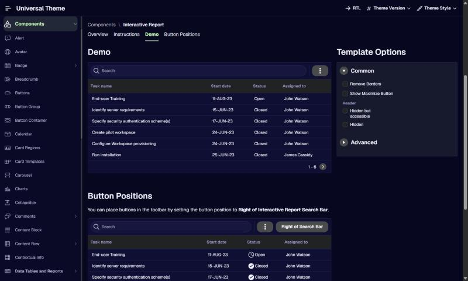
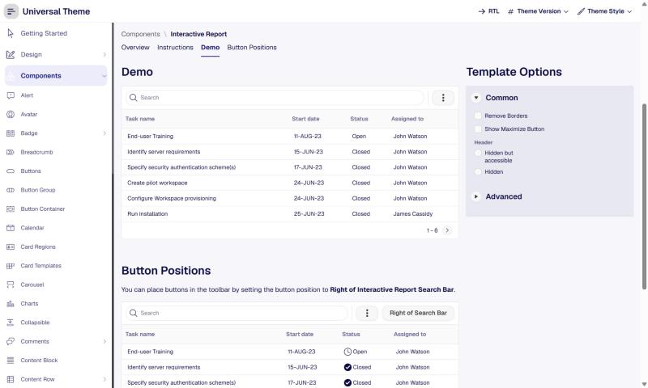

# Setproduct Nocra -> Oracle APEX

**Category:** AI product  |  **Kit:** https://www.setproduct.com/templates/nocra  |  **Modes:** dark, light (default dark)

Read `../apex-setproduct-themes/SKILL.md` first for the shared method (native-first rules, install steps,
component map). This file only holds what is specific to Nocra.

## Preview
**Dark**



**Light**



*Oracle's Universal Theme reference app (APEX 26.2, Interactive Report page), stock markup + this theme's CSS only.*

## The look
- Deep midnight-navy canvas with soft glows; mint-green primary actions.
- Large rounded prompt inputs, prompt-history lists, AI status panels, style selectors.
- Microinteractions: loaders, thinking shimmer, success/error motion.

**Fonts:** body `Geist`, headings `Geist` (loaded from Google Fonts by the CSS `@import`;
self-host them as Static Application Files if the app's CSP blocks fonts.googleapis.com).

## Files
- `theme-dark.css` - dark mode; create the Theme Style from **Vita - Dark** (default)
- `theme-light.css` - light mode; create the Theme Style from **Vita**

Each file is self-contained (font import + `--sp-*` tokens + base bridge + Nocra signature rules).

## Key tokens (dark)
| Token | Value |
|---|---|
| `--sp-primary` | `#CCFCBC` |
| `--sp-accent` | `#CCFCBC` |
| `--sp-success` | `#2ECC8F` |
| `--sp-warning` | `#F5B544` |
| `--sp-danger` | `#F40C04` |
| `--sp-info` | `#C4DCFC` |
| `--sp-bg` | `#07071F` |
| `--sp-surface` | `#0F0F33` |
| `--sp-border` | `#24245A` |
| `--sp-text` | `#F2F2FF` |
| `--sp-text-muted` | `#9B9BC9` |
| `--sp-nav-bg` | `#0A0A26` |
| `--sp-nav-active-bg` | `rgba(204,252,188,.12)` |
| `--sp-radius-md` | `12px` |
| `--sp-radius-lg` | `20px` |
| `--sp-btn-radius` | `12px` |

To re-tint, change tokens in `src/themes.py` and run `python build.py` - or override just the `--sp-*`
variables in Theme Roller's **Custom CSS** box, which loads after the file.

## Build it with native components
| Kit element | Native APEX implementation |
|---|---|
| AI chat / assistant | Dynamic Action `Show AI Assistant` (APEX 24.1+, native) - styled via --a-chat-* vars |
| Prompt input | Textarea item, Template `Optional`, CSS class `sp-prompt` on the item (Advanced > CSS Classes) + Hot icon button |
| Prompt history | Content Row or Media List template component |
| Style / model selector | Radio Group, Template Option `Display as Pill Button`, or Cards region with selectable cards |
| Generation status panel | Badge template component + CSS class `sp-thinking` while running |
| Server call | APEX_AI.GENERATE (24.1+) in a PL/SQL process or Ajax callback |

Everything else follows the shared component map (`../apex-setproduct-themes/references/component-map.md`).

**Signature utility classes** (put in a region's or item's *Appearance > CSS Classes*): `sp-prompt`, `sp-thinking`

## Charts
Paste into each Chart region's **Attributes > Advanced > Initialization JavaScript Function**:

```javascript
function( options ) {
    options.styleDefaults = options.styleDefaults || {};
    options.styleDefaults.colors = [ "#CCFCBC", "#C4DCFC", "#8E8EFF", "#2ECC8F", "#F5B544", "#FF7A7A", "#5EEAD4", "#E9D5FF" ];
    return options;
}
```

## Dark / light
Both modes ship. Create one Theme Style per mode, mark both **Is Public = Yes**, and in Shared Components > User Interface Attributes enable end users to choose the theme style, so users can switch from the runtime *Customize* dialog (see `references/install.md` step 3).

## Verify
1. Run a page with a Side Menu, a Cards region, an Interactive Report, a form with Floating labels and a Hot button.
2. Check the side menu's current item, focus rings (Tab key), Hot button contrast, and the IR header in both modes.
3. Check the Login page (page template *Login*) and a Modal Dialog.
4. Compare side by side with the kit preview at https://www.setproduct.com/templates/nocra and nudge tokens, not selectors.
