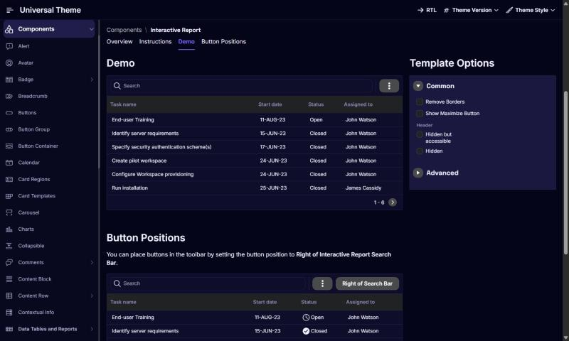

# Setproduct Orion -> Oracle APEX

**Category:** Data visualization  |  **Kit:** https://www.setproduct.com/templates/orion  |  **Modes:** dark, light (default dark)

Read `../apex-setproduct-themes/SKILL.md` first for the shared method (native-first rules, install steps,
component map). This file only holds what is specific to Orion.

## Preview


*Dark mode on Oracle's Universal Theme reference app (APEX 26.2, Interactive Report page, stock markup + this theme's CSS only).*

## The look
- Deep indigo 'night sky' canvas; neon violet, electric blue and cyan series.
- Full-width chart templates: world maps, bubble, heat maps, hexagon grids, connection graphs.
- Glows and radial gradients behind hero numbers; light variant on lavender-white.

**Fonts:** body `Inter`, headings `Space Grotesk` (loaded from Google Fonts by the CSS `@import`;
self-host them as Static Application Files if the app's CSP blocks fonts.googleapis.com).

## Files
- `theme-dark.css` - dark mode; create the Theme Style from **Vita - Dark** (default)
- `theme-light.css` - light mode; create the Theme Style from **Vita**

Each file is self-contained (font import + `--sp-*` tokens + base bridge + Orion signature rules).

## Key tokens (dark)
| Token | Value |
|---|---|
| `--sp-primary` | `#8474FC` |
| `--sp-accent` | `#04F4E4` |
| `--sp-success` | `#2EE6A8` |
| `--sp-warning` | `#FFB547` |
| `--sp-danger` | `#FF4D8D` |
| `--sp-info` | `#043CFC` |
| `--sp-bg` | `#05051A` |
| `--sp-surface` | `#0E0E2A` |
| `--sp-border` | `#23234D` |
| `--sp-text` | `#F2F2FF` |
| `--sp-text-muted` | `#8D8DB8` |
| `--sp-nav-bg` | `#08081F` |
| `--sp-nav-active-bg` | `rgba(132,116,252,.2)` |
| `--sp-radius-md` | `10px` |
| `--sp-radius-lg` | `16px` |
| `--sp-btn-radius` | `10px` |

To re-tint, change tokens in `src/themes.py` and run `python build.py` - or override just the `--sp-*`
variables in Theme Roller's **Custom CSS** box, which loads after the file.

## Build it with native components
| Kit element | Native APEX implementation |
|---|---|
| World map / continent data | Map region (native, APEX 21.1+) with Choropleth or Bubbles layer; colour layers from the chart palette |
| Bubble, heat map, polar charts | Chart region: Bubble, Polar, or Status Meter Gauge; hexagons need a Treemap or custom SVG |
| Connection graphs | not native - use Treemap/Sunburst charts, or Oracle's Graph Visualization plug-in |
| Hero metric with glow | Static Content + CSS class `sp-glow` |

Everything else follows the shared component map (`../apex-setproduct-themes/references/component-map.md`).

**Signature utility classes** (put in a region's or item's *Appearance > CSS Classes*): `sp-glow`

## Charts
Paste into each Chart region's **Attributes > Advanced > Initialization JavaScript Function**:

```javascript
function( options ) {
    options.styleDefaults = options.styleDefaults || {};
    options.styleDefaults.colors = [ "#8474FC", "#04F4E4", "#043CFC", "#FF4D8D", "#FFB547", "#2EE6A8", "#BCB4FC", "#5B8CFF" ];
    return options;
}
```

## Dark / light
Both modes ship. Create one Theme Style per mode, mark both **Is Public = Yes**, and in Shared Components > User Interface Attributes enable end users to choose the theme style, so users can switch from the runtime *Customize* dialog (see `references/install.md` step 3).

## Verify
1. Run a page with a Side Menu, a Cards region, an Interactive Report, a form with Floating labels and a Hot button.
2. Check the side menu's current item, focus rings (Tab key), Hot button contrast, and the IR header in both modes.
3. Check the Login page (page template *Login*) and a Modal Dialog.
4. Compare side by side with the kit preview at https://www.setproduct.com/templates/orion and nudge tokens, not selectors.
