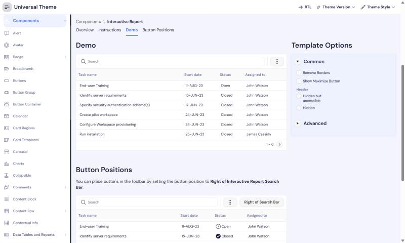

# Setproduct Rome -> Oracle APEX

**Category:** Dashboard  |  **Kit:** https://www.setproduct.com/templates/rome  |  **Modes:** light (default light)

Read `../apex-setproduct-themes/SKILL.md` first for the shared method (native-first rules, install steps,
component map). This file only holds what is specific to Rome.

## Preview
**Light**



*Oracle's Universal Theme reference app (APEX 26.2, Interactive Report page), stock markup + this theme's CSS only.*

## The look
- Very light lavender canvas, pure white cards with generous 20px radius.
- Periwinkle-blue primary, peach and pink secondary accents.
- Soft blue-tinted shadows instead of borders; rounded pill controls and switches.

**Fonts:** body `DM Sans`, headings `DM Sans` (loaded from Google Fonts by the CSS `@import`;
self-host them as Static Application Files if the app's CSP blocks fonts.googleapis.com).

## Files
- `theme-light.css` - light mode; create the Theme Style from **Vita** (default)

Each file is self-contained (font import + `--sp-*` tokens + base bridge + Rome signature rules).

## Key tokens (light)
| Token | Value |
|---|---|
| `--sp-primary` | `#4C74FC` |
| `--sp-accent` | `#FCA44C` |
| `--sp-success` | `#2FB67C` |
| `--sp-warning` | `#FCA44C` |
| `--sp-danger` | `#F2617A` |
| `--sp-info` | `#8CA4FC` |
| `--sp-bg` | `#F4F5FC` |
| `--sp-surface` | `#FFFFFF` |
| `--sp-border` | `#E7EAF7` |
| `--sp-text` | `#1B1F3B` |
| `--sp-text-muted` | `#7A80A6` |
| `--sp-nav-bg` | `#FFFFFF` |
| `--sp-nav-active-bg` | `#EEF2FF` |
| `--sp-radius-md` | `12px` |
| `--sp-radius-lg` | `20px` |
| `--sp-btn-radius` | `12px` |

To re-tint, change tokens in `src/themes.py` and run `python build.py` - or override just the `--sp-*`
variables in Theme Roller's **Custom CSS** box, which loads after the file.

## Build it with native components
| Kit element | Native APEX implementation |
|---|---|
| Calendar picker card | Date Picker item, Display As = Inline; region template Standard |
| Pill tabs | Region Display Selector or Tabs Container with Template Options `Style = Pill` |
| Sliders / switches | Number Field with range is not native: use Switch item; for ranges use two Number Fields |
| Profile card | Cards region with Initials/Avatar slot, centered body |

Everything else follows the shared component map (`../apex-setproduct-themes/references/component-map.md`).

**Signature utility classes** (put in a region's or item's *Appearance > CSS Classes*): none - the base layer covers this kit

## Charts
Paste into each Chart region's **Attributes > Advanced > Initialization JavaScript Function**:

```javascript
function( options ) {
    options.styleDefaults = options.styleDefaults || {};
    options.styleDefaults.colors = [ "#4C74FC", "#FCA44C", "#FC8CA4", "#8CA4FC", "#2FB67C", "#BCCCFC", "#FCDCB4", "#A78BFA" ];
    return options;
}
```

## Dark / light
This kit is light-only; no second style is needed.

## Verify
1. Run a page with a Side Menu, a Cards region, an Interactive Report, a form with Floating labels and a Hot button.
2. Check the side menu's current item, focus rings (Tab key), Hot button contrast, and the IR header in both modes.
3. Check the Login page (page template *Login*) and a Modal Dialog.
4. Compare side by side with the kit preview at https://www.setproduct.com/templates/rome and nudge tokens, not selectors.
