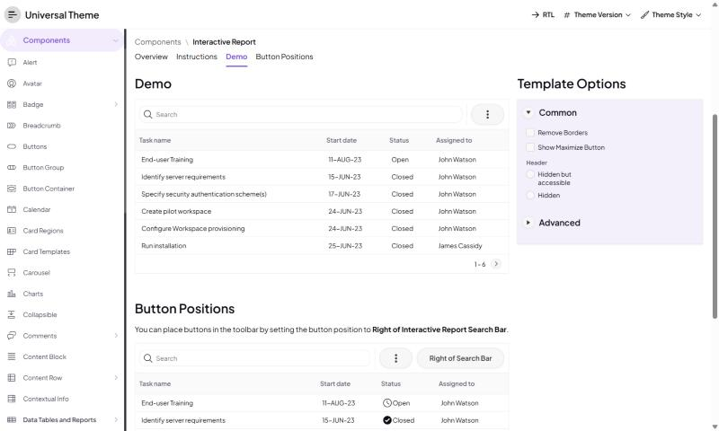

# Setproduct Zeus -> Oracle APEX

**Category:** Landing pages  |  **Kit:** https://www.setproduct.com/templates/zeus  |  **Modes:** light (default light)

Read `../apex-setproduct-themes/SKILL.md` first for the shared method (native-first rules, install steps,
component map). This file only holds what is specific to Zeus.

## Preview
**Light**



*Oracle's Universal Theme reference app (APEX 26.2, Interactive Report page), stock markup + this theme's CSS only.*

## The look
- White sections alternating with near-black hero/CTA bands.
- Teal and violet accents; pill-shaped CTAs; airy 24px-radius feature cards.
- Blocks: hero, features, FAQ, blog, pricing, testimonials, team, footer.

**Fonts:** body `Plus Jakarta Sans`, headings `Plus Jakarta Sans` (loaded from Google Fonts by the CSS `@import`;
self-host them as Static Application Files if the app's CSP blocks fonts.googleapis.com).

## Files
- `theme-light.css` - light mode; create the Theme Style from **Vita** (default)

Each file is self-contained (font import + `--sp-*` tokens + base bridge + Zeus signature rules).

## Key tokens (light)
| Token | Value |
|---|---|
| `--sp-primary` | `#845CD4` |
| `--sp-accent` | `#3CB4AC` |
| `--sp-success` | `#4CBC7C` |
| `--sp-warning` | `#F5B544` |
| `--sp-danger` | `#E5484D` |
| `--sp-info` | `#3CB4AC` |
| `--sp-bg` | `#FFFFFF` |
| `--sp-surface` | `#FFFFFF` |
| `--sp-border` | `#ECECF2` |
| `--sp-text` | `#0C0C14` |
| `--sp-text-muted` | `#6A6A7C` |
| `--sp-nav-bg` | `#FFFFFF` |
| `--sp-nav-active-bg` | `#F2ECFC` |
| `--sp-radius-md` | `14px` |
| `--sp-radius-lg` | `24px` |
| `--sp-btn-radius` | `999px` |

To re-tint, change tokens in `src/themes.py` and run `python build.py` - or override just the `--sp-*`
variables in Theme Roller's **Custom CSS** box, which loads after the file.

## Build it with native components
| Kit element | Native APEX implementation |
|---|---|
| Hero | Hero region template (set Heading Level to H1) + CSS class `sp-section-dark` |
| Features grid | Cards region, Layout = Grid, Grid Columns = 3, Icon slot |
| Pricing | Cards region (one card per plan) with Actions = Button |
| FAQ | Collapsible regions (Template = Collapsible, Template Option `Remove borders`) |
| Testimonials / team | Cards region with Initials/Avatar or Media List |
| Page shell | Public page (Authentication = Public), Page Template `Minimal (No Navigation)` |

Everything else follows the shared component map (`../apex-setproduct-themes/references/component-map.md`).

**Signature utility classes** (put in a region's or item's *Appearance > CSS Classes*): `sp-section-dark`

## Charts
Paste into each Chart region's **Attributes > Advanced > Initialization JavaScript Function**:

```javascript
function( options ) {
    options.styleDefaults = options.styleDefaults || {};
    options.styleDefaults.colors = [ "#845CD4", "#3CB4AC", "#4CBC7C", "#B4F4FC", "#9484C4", "#F5B544", "#A4B4E4", "#E5484D" ];
    return options;
}
```

## Dark / light
This kit is light-only; no second style is needed.

## Verify
1. Run a page with a Side Menu, a Cards region, an Interactive Report, a form with Floating labels and a Hot button.
2. Check the side menu's current item, focus rings (Tab key), Hot button contrast, and the IR header in both modes.
3. Check the Login page (page template *Login*) and a Modal Dialog.
4. Compare side by side with the kit preview at https://www.setproduct.com/templates/zeus and nudge tokens, not selectors.
